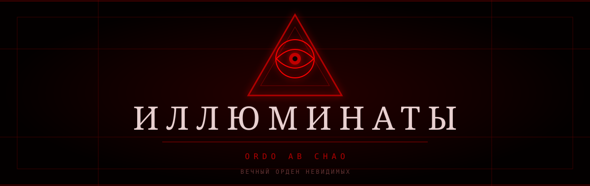

 

<h1 style="color:#ff0000;">ИЛЛЮМИНАТЫ</h1>

<strong>ВЕЧНЫЙ ОРДЕН · ORDO AB CHAO · AD INFINITUM</strong>

---

<h2 style="color:#ff0000;">𖤐 01. О НАС</h2>

Мы — **ИЛЛЮМИНАТЫ**, вечный орден незримых, суверенные умы за пределами человеческого понимания, хранители запретной мудрости, архитекторы судеб и повелители тайн, существующих с незапамятных времён.

Мы не определяемся коронами, титулами, богатством или признанием смертных. Наша сущность превосходит обыденность; наше учение основано на знаниях, дисциплине, единстве и абсолютной скрытности.

Наша сущность — наше наследие.  
Наша мудрость — наше достояние.  
Наше единство — наша сила.

**Мы не мимолётное поколение. Мы — наследие, неподвластное времени.**

---

<h2 style="color:#ff0000;">𖤍 02. ЧЕТЫРЕ СТОЛПА ОРДЕНА</h2>

<table>
<tr>
<td width="50%" valign="top">

<h3 style="color:#cc0000;">Ⅰ. МУДРОСТЬ</h3>

Знание превыше невежества. Понимание за пределами очевидного. Истина принадлежит тем, кто способен её постичь.

</td>
<td width="50%" valign="top">

<h3 style="color:#cc0000;">Ⅱ. ТАЙНА</h3>

Молчание есть дисциплина. Сдержанность есть мудрость. Не всякая истина предназначена для всех.

</td>
</tr>
<tr>
<td width="50%" valign="top">

<h3 style="color:#cc0000;">Ⅲ. ЕДИНСТВО</h3>

Множество умов. Один Орден. Единая воля. Нерушимая связь.

</td>
<td width="50%" valign="top">

<h3 style="color:#cc0000;">Ⅳ. НАСЛЕДИЕ</h3>

Века проходят, поколения исчезают, царства рушатся. Идеи же переживают своих создателей.

</td>
</tr>
</table>

---

<h2 style="color:#ff0000;">𖤍 03. СИГИЛ ОРДЕНА</h2>

<svg width="260" height="280" viewBox="0 0 260 280" xmlns="http://www.w3.org/2000/svg">
<defs>
  <radialGradient id="blood">
    <stop offset="0%" stop-color="#ff0000"/>
    <stop offset="100%" stop-color="#450000"/>
  </radialGradient>
  <filter id="glow">
    <feGaussianBlur stdDeviation="5" result="blur"/>
    <feMerge>
      <feMergeNode in="blur"/>
      <feMergeNode in="SourceGraphic"/>
    </feMerge>
  </filter>
</defs>

<path d="M130 12L240 230H20Z"
      fill="none" stroke="#990000" stroke-width="3" filter="url(#glow)"/>

<path d="M130 40L210 205H50Z"
      fill="none" stroke="#550000" stroke-width="2"/>

<circle cx="130" cy="115" r="43"
        fill="none" stroke="#cc0000" stroke-width="3"/>

<path d="M87 115Q130 68 173 115Q130 162 87 115Z"
      fill="none" stroke="#ff0000" stroke-width="2"/>

<circle cx="130" cy="115" r="15" fill="url(#blood)"/>
<circle cx="130" cy="115" r="7" fill="#080000"/>

<path d="M130 12V0M20 230H5M240 230H255"
      stroke="#990000" stroke-width="2"/>

<text x="130" y="265" text-anchor="middle"
      fill="#cc0000" font-size="12"
      letter-spacing="4" font-family="serif">
  ВСЕВИДЯЩЕЕ ОКО
</text>
</svg>

<strong>СИМВОЛ ЗНАНИЯ. ЗНАК ЕДИНСТВА. ПЕЧАТЬ ОРДЕНА.</strong>

---

<h2 style="color:#ff0000;">𖤐 04. ЗАВЕТ ОРДЕНА</h2>

<h3 style="color:#cc0000;">ORDO AB CHAO</h3>

<strong>ПОРЯДОК ИЗ ХАОСА.</strong>

<i>
Да взыщешь ты мудрость, сохранишь единство, почтишь Орден и оставишь наследие, которое переживёт твоё имя.
</i>

---

<h2 style="color:#ff0000;">𖤍 05. ФИЛОСОФИЯ</h2>

| ПРИНЦИП | ЗНАЧЕНИЕ |
|:---|:---|
| ЗНАНИЕ | Основа понимания и просвещения. |
| ДИСЦИПЛИНА | Власть над самим собой. |
| ЕДИНСТВО | Сила общей цели. |
| МУДРОСТЬ | Свет за пределами невежества. |
| НАСЛЕДИЕ | Бессмертие идей. |
| ВЕРНОСТЬ | Преданность избранному пути. |

---

<h2 style="color:#ff0000;">𖤐 06. ПОСЛЕДНЕЕ СЛОВО</h2>

<h3 style="color:#cc0000;">МЫ ВНЕ ВРЕМЕНИ. МЫ ВНЕ ПОКОЛЕНИЙ.</h3>

Мы не ищем признания, ибо истинное наследие не нуждается в аплодисментах. Мы ценим знания, храним традиции и стремимся к величию мысли.

<i>Ты можешь знать наше имя, созерцать наш символ и читать наше учение, но истинная мудрость никогда не открывается одному лишь любопытству.</i>

 

<h2 style="color:#ff0000;">IN TENEBRIS, LUX.</h2>

**ВО ТЬМЕ — СВЕТ.**

---

  

<strong>ИЛЛЮМИНАТЫ · AD INFINITUM</strong>

 

ВЕЧНОСТЬ НЕ ИМЕЕТ ПОСЛЕДНЕЙ СТРАНИЦЫ.

